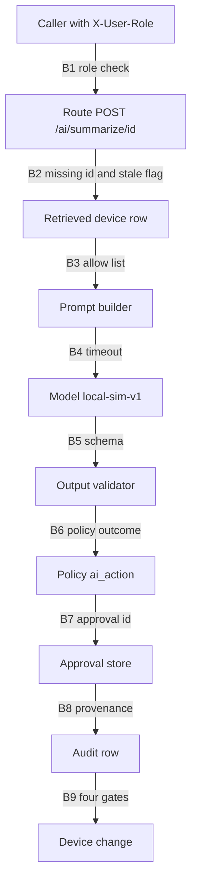

# Trust boundary diagram

| Field | Value |
|---|---|
| Stage | S04-09 — AI security and guardrails (Challenge 9), Half A |
| Date / version | 2026-10-11, v1.0 |
| Author | Mangesh (FDE), drafted with Cursor |
| Status | CONDITIONAL PASS. The diagram names eight boxes and the control on each boundary between them. The timeout number on the model boundary stays unset. Owner: Team-Force. Label: PROPOSED. |
| Evidence sources | `apps/api/main.py`; `apps/api/services/ai_gateway.py`; `apps/api/services/policy.py`; `apps/api/services/audit.py`; `semantic-layer/ai-context-policy.yaml`; `docs/06-policy/ai-action-policy-design.md`; `docs/09-ai-guardrails/ai-risk-register.md` |
| Assumptions | One policy call happens after the gateway has set the three flags, and before the HTTP body is returned. Stops that need no model (denied role, missing id, forbidden field, stale flag) skip the model and still return a policy outcome. |
| Unresolved issues | `prompt_template_version` has no box, because it has no YAML id. The approval box stores nothing until S07. |
| Residual risks | Today the route can return the raw gateway dict, which has no `outcome` (`main.py` lines 82 to 84). The diagram is the target order. Half B makes the route follow it. |

## What this file is

This file shows where a summary call is trusted, and which check sits on each hand-off. The caller, the device row, and the model are untrusted. The route, the prompt builder, the validator, the policy, and the audit row are the checks.

Claim labels: **Verified Fact**, **Inference**, **Assumption**, **Unknown**.

## Diagram

The arrows are the nine boundaries. A stop on B1 through B6 returns an HTTP body and still writes an audit row. This stage's route does not cross B9. The approval box is drawn so the later change path has a place to store an id. No route writes that id today.

## What sits on each boundary

| Boundary | From | To | Control | YAML id | What crosses | What stays behind |
|---|---|---|---|---|---|---|
| B1 | Caller | Route | Access check for `action.summarize`. A missing header is denied. | `rule.no_default_role`; `action.summarize`; `provenance.policy_result` | The role word and the record id, when access allows. | The device row. A denied caller does not load it (`main.py` lines 68 to 70). |
| B2 | Route | Retrieved record | Missing id is BLOCK. A true stale flag is BLOCK. A blank or missing flag is HOLD_FOR_REVIEW. | `failmode.missing_id`; `failmode.stale_topology_true`; `failmode.stale_topology_blank` | A found row whose flag is false. | `REC-0001` substituted for a missing id. The model. |
| B3 | Retrieved record | Prompt builder | Only allow-listed fields are copied into the prompt. A forbidden field in that text is BLOCK. | `policy.prompt_fields`; `failmode.forbidden_field_in_prompt`; `rule.forbidden_fields_never_enter_prompt` | `device_id`, `hostname`, `vendor`, and the other allowed device fields. | `mgmt_ip`, `credential_profile`, and the credential names in `forbidden_credential_names`. |
| B4 | Prompt builder | Model | The call has a deadline. The prompt hash is computed before the call. | `failmode.timeout`; `provenance.prompt_hash` | The prompt text, inside the process. | The prompt text does not go to the audit row. On timeout, no answer crosses back. |
| B5 | Model | Output validator | The answer is JSON matching `policy.output_schema`. A bad answer is discarded. | `policy.output_schema`; `failmode.schema_failure`; `policy.fail_to_person` | A schema-valid object whose recommendation is text. | A malformed body, a missing field, a model `outcome` of EXECUTE, and any synthetic replacement sentence. |
| B6 | Output validator | Policy | `ai_action` returns the outcome. The model's own outcome word is ignored. | `policy.outcomes`; `outcome.recommend_only`; `outcome.hold_for_review`; `outcome.block` | The flags the gateway measured, plus the persona, action, and record facts. | A raw summary with no policy outcome. The word EXECUTE. This route's action is `action.summarize`, whose healthy outcome is RECOMMEND_ONLY (row O1). |
| B7 | Policy | Approval | A person accepts or rejects text. The model does not write the approval id. | `provenance.approval_id`; `ai_use.incident_summary`; `ai_use.next_action_recommendation`; `ai_use.remediation_execution` | The record id, the outcome, the reasons, and the summary only when the schema passed and the outcome is one that shows text. | `mgmt_ip` and `credential_profile`. The prompt text. |
| B8 | Approval | Audit | The fourteen audit fields. Provenance values are filled only when the model ran. | `policy.provenance`; `rule.audit_row_names_actor_and_correlation` | `model`, `model_version`, `prompt_hash`, `tokens`, `latency_ms`, `outcome`, actor, correlation id. | The prompt text. The two forbidden device fields. A fake summary. |
| B9 | Audit | Device change | Four gates, all true, before any change. This route does not call a change. | `outcome.execute`; `rule.ai_recommendation_needs_policy_approval_audit_before_state_change`; `rule.ai_output_cannot_execute` | Nothing, from `POST /ai/summarize/{id}`. | The recommendation sentence. It stays text. |

Worked example. Caller sends `POST /ai/summarize/REC-0001` with `X-User-Role: operator`. B1 allows the call because TA-06 matches `persona.noc_operator` for `action.summarize` on `resource.device`. B2 sees `device_id` `REC-0001` and `stale_topology_flag` false (`devices.csv` line 2), so the row continues. B3 copies allowed fields and leaves `mgmt_ip` and `credential_profile` out. B4 calls the stub. B5 checks the answer. B6 asks `ai_action` with the flags from that call. The HTTP body is the policy outcome. The call stops before the device-change box.

Same caller, id `DEV-00003`. B2 sees `stale_topology_flag` true (`devices.csv` line 4). The outcome is BLOCK. The model box is not entered. The audit row has `outcome` BLOCK and null provenance values.

## Where today's code sits

| Box | Today | Target in this diagram |
|---|---|---|
| Route | Role check and `decide_summarize` run before the gateway (`main.py` lines 66 to 84). | Same check. The body is always the policy outcome. |
| Retrieved record | `load_record` returns the first row when the id is missing (`domain_service.py` lines 14 to 15). | The policy treats that as not found when `device_id` differs from the requested id (`policy.py` line 359). |
| Prompt builder | The whole row is interpolated (`ai_gateway.py` line 7). | Allow list only. |
| Model | Stub `local-sim-v1`. Sleep 0.01 seconds. No deadline. | Same stub, with a deadline whose production number is unset. |
| Output validator | Absent. `output_schema_ok` is forced true. | Schema check. Failure discards the answer. |
| Policy | Called with placeholder gateway flags (`policy.py` lines 328 to 344). | Called with flags from the real call. |
| Approval | No store. `approval_id` is null. | Still null in this stage. S07 writes it. |
| Audit | Fourteen keys. Provenance values null (`audit.py` lines 69 to 74). | Provenance filled when the model ran. |
| Device change | No route. | Still no route. |

## Findings

| Id | Finding | Evidence | Impact | Risk | Confidence | Open questions |
|---|---|---|---|---|---|---|
| TB-01 | The untrusted boxes are the caller, the device row, and the model. | **Verified Fact.** The prompt template takes `{record}` (`ai_gateway.py` line 4). The model is a stub that does not validate (`policy.model_today`). | Checks belong on the arrows, not inside the model. | A check placed only inside the stub is skipped when the stub is replaced. | High | None. |
| TB-02 | The success path returns the gateway dict and skips the policy outcome. | **Verified Fact.** `main.py` lines 82 to 84. | The caller can read a recommendation with `guardrail_status` `not_enforced`. | AIR-04 and AIR-08. | High | None. |
| TB-03 | B9 is drawn and not used by this route. | **Verified Fact.** `main.py` has no execute route. `outcome.execute` names the four gates. | A reader of the diagram can see the change box and think this stage opens it. | This file states the route does not cross B9. | High | The meaning of "validated" is still the S04-06 open question. |

## Lifecycle

Stage S07 adds the approval write on B7 and the route `/ai/recommend`. Stage S04-11 uses the timeout on B4 as the AI-down drill. The risk ids AIR-01 through AIR-09 map to B3, B3, B2, B5, B4, B8, B1, B9, and B6 in that order.
