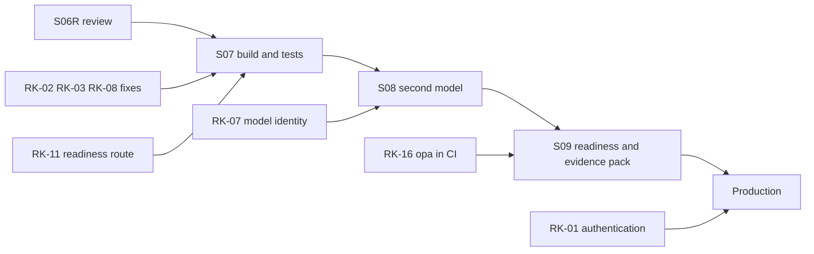

# Risk management: recommendations for PRD section 12

| Field | Value |
|---|---|
| Stage | S06 follow-up. Recommendations for each risk in `docs/prd/prd.md` section 12. Applied on 2026-10-12 by ADR 0003 and PRD v1.1. |
| Date / version | 2026-10-12, v1.1 |
| Author | Cursor agent (Claude Sonnet 5.5) for Mangesh (FDE) |
| Status | CONDITIONAL PASS. The three Team-Force choices are decided in ADR 0003. Six new requirements (RQ-68 to RQ-73) and the extra text on RQ-31 are in the PRD. S07 still has to write the code and the 43 planned tests. RQ-31 is deferred (ADR 0004). |
| Evidence sources | **Semantic layer version `1.1.1`.** `docs/prd/prd.md` section 12 (RK-01 to RK-17); `docs/prd/traceability.md`; `docs/13-security-validation/remediation-backlog.md` (SB-01 to SB-20); `docs/09-ai-guardrails/ai-risk-register.md` (AIR-01 to AIR-09); `docs/11-reliability/degraded-mode-design.md`; `docs/02-baseline/defect-list.md`; `docs/02-baseline/S05R_Decisions_Taken.md`; `docs/ADR/0002-s05r-deferred-and-proposed-decisions.md`; `docs/12-finops/optimization-backlog.md` (`OB-01`); `docs/03-identity/current-role-matrix.md`; `playbook/S06-prd.md`; `playbook/S09-readiness-and-evidence-pack.md`; `apps/api/main.py`; `apps/api/services/policy.py`; `apps/api/services/ai_gateway.py`; `apps/api/services/audit.py` |
| Assumptions | (1) Mangesh (FDE) speaks for Team-Force on open choices (`operating-contract.md` row 10). (2) S07 builds only what the PRD names. A recommendation that needs code becomes a PRD requirement first. (3) Authentication is not required in `Project_Intent.md`. A search of the project files found no authentication requirement. The challenge guide PDF was not searched as text. (4) The model stays the stub `local-sim-v1` until S08. |
| Unresolved issues | The letters of MAESTRO (D-20). Thirteen Open questions for S03 stay open (`prd.md` section 15). The cap on stored answers has no number. |
| Residual risks | A risk stays open until S07 writes the code, or until the named later stage. Authentication stays out of scope, so `approver` and `actor` stay claims. |

Claim labels: **Verified Fact**, **Inference**, **Assumption**, **Unknown**.

Paths are relative to `06-telecom-service-network-incident-ops/`.

## 1. How to use this file

This file is the recommendation list for the 17 risks in `docs/prd/prd.md` section 12. On 2026-10-12 Mangesh (FDE) accepted the three choices. ADR 0003 records them. PRD v1.1 adds RQ-68 to RQ-73. S07 builds the code. S09 can copy the accepted-risk table into `risk-owner-table.md`.

Five actions are used below.

| Action | What it means |
|---|---|
| Fix | Change existing code or an existing test. |
| Build | Add a small feature that does not exist today. |
| Decide | A choice only Team-Force can make. No code until the choice is written. |
| Accept | Keep the gap visible. Name an owner. Write the limit on the page or in the defence notes. |
| Defer | Wait for a named trigger. Do no work until that trigger happens. |

Every owner is Team-Force. Every proposed number or date keeps the word PROPOSED.

## 2. Summary

| Risk | In plain words | Action | Effort | Stage | Owner |
|---|---|---|---|---|---|
| RK-01 | The role is a word the caller types | Decide, then Accept for the lab | Large if built. None if accepted. | S06R (decide). Production if built. | Team-Force |
| RK-02 | A call with no role header is treated as `operator` | Fix | Small | S07, after the F15 decision | Team-Force |
| RK-03 | Header text is stored in the audit log unchanged | Fix | Small | S07 | Team-Force |
| RK-04 | The model answer is not checked for forbidden values | Build | Small | S07, before a real model | Team-Force |
| RK-05 | The command-phrase list is short | Accept, with a process | Small | S07 (the list and the tests) | Team-Force |
| RK-06 | A secret typed inside an allowed field is not found | Defer | Medium | When a real model arrives (D-09) | Team-Force |
| RK-07 | The model name and the model version are the same text | Defer | Small | S08 | Team-Force |
| RK-08 | The audit log is a plain file that mixes test and real rows | Fix and Accept | Small for the test-log split. Large for tamper evidence. | S07 for the test log. Production for tamper evidence. | Team-Force |
| RK-09 | No limit on request rate, prompt size or answer size | Accept, small Build | Small | S07 for size limits. Production for rate limits. | Team-Force |
| RK-10 | A held case has no inbox | Accept, optional Build | Small if the page list is built | S07 optional. Production for a queue. | Team-Force |
| RK-11 | `/health` returns 200 in every failure | Build | Medium-small | S07 | Team-Force |
| RK-12 | Four scopes need data the CSV files lack | Accept | None | Defence notes. Later when the data exists. | Team-Force |
| RK-13 | Eleven rules say `enforced_today: false` | Fix by process | Small | After S07, then S09 | Team-Force |
| RK-14 | A stored answer can repeat for 300 seconds | Decide | Small if kept. None if dropped. | S06R (decide). S07 if kept. | Team-Force |
| RK-15 | Every time, token and cost number comes from a stub | Accept | None | After a real model is measured (D-11) | Team-Force |
| RK-16 | Two Rego-versus-Python tests skip when `opa` is missing | Fix | Small | S09 CI run | Team-Force |
| RK-17 | The data files have known faults | Accept | None | Ask the data owner. Do not clean the files in this packet. | Team-Force |

## 3. Priority order

Act on these five first.

1. **RK-02.** Small. Closes a real hole on `GET /records/{id}`.
2. **RK-08, the test-log split.** Small. Stops test rows entering `logs/audit.log`.
3. **RK-01 decision (D-07).** Record the choice in an ADR. Build nothing until then.
4. **RK-04 and RK-05.** Do both before any real model.
5. **RK-11.** A readiness route so a monitor can see an outage.

## 4. One section per risk

Each section has the same four lines: what the risk is, the recommendation, the PRD change it needs, and the trigger to revisit.

### RK-01. The role is a word the caller types

**What the risk is.** The server reads `X-User-Role` and nothing else. **Verified Fact:** `apps/api/main.py`. Anyone who can reach the app can send `admin` and read the audit log, or send `operator` and store a yes. The approval record then holds `approver` as that claimed word. Source: SB-09, `rule.shared_admin_not_least_privilege`, D-07.

**Recommendation.** Decide, then Accept for the lab. Keep authentication out of scope (D-07). The PRD already shows the role as a claim (RQ-65). Add one wording rule: `approver` and `actor` are shown as "claimed role". Write the production need in the defence notes: a token per persona, with the server setting the role. Record the decision in an ADR. I searched the project files for an authentication requirement and found none. Check the challenge guide PDF before you rule it out.

**PRD change.** None if Team-Force accepts D-07 as written. If Team-Force wants the token step in S07, add a new requirement, new YAML ids and a new ADR. That is Option B in the table in section 6.

**Trigger to revisit.** The app is reachable by more than the team. Or Team-Force chooses Option B.

### RK-02. A call with no role header is treated as `operator`

**What the risk is.** `GET /records/{id}` fills in `operator` when no header arrives. The body can include `mgmt_ip` and `credential_profile`. The storm, recommend and approval routes do not exist yet. The PRD requires each one to refuse a call with no header (RQ-11, RQ-28, RQ-35). **Verified Fact:** `main.py` line 69 (`Header(default="operator")`). `policy.py` lines 290, 297, 310 and 325 hold the two fallbacks (SB-02). Tests that lock the old behaviour: `tests/access/test_negative_access.py::test_missing_role_header_keeps_operator_default` and `policy/tests/test_policy_python.py::test_record_route_keeps_missing_header_default_operator`. Source: F15, SB-01, SB-02, `rule.no_default_role`.

**Recommendation.** Fix. Remove the header default and the two fallbacks. Change the two tests to expect HTTP 403, a `policy.deny` row and `role` null. The summarize route already behaves that way. Small effort. Team-Force decides first, because the SB-01 plan row says "Decision needed".

**PRD change.** Add a requirement before S07. Proposed test: `tests/app/test_records_route.py::test_missing_header_returns_403_and_a_deny_row`. YAML id already exists: `rule.no_default_role`. Turn the flag `enforced_today` to true under a new ADR after the code runs.

**Trigger to revisit.** Team-Force says no. Then leave F15 visible and keep the two tests as gap locks.

### RK-03. Header text is stored in the audit log unchanged

**What the risk is.** Text from `X-User-Role` and `X-Correlation-Id` is written to `logs/audit.log` as sent. A role of `mgmt_ip=10.1.1.1 password=hunter2` and a 5000-character id were stored whole. **Verified Fact:** SB-03, Probe 1. The audit route already refuses a case id longer than 128 characters (N-01). The write path does not.

**Recommendation.** Fix. Check the role word against the known list in `HEADER_ROLE_IDS` before it is logged. Store a fixed word for any other value. Apply the 128 character limit when the row is written, not only when it is read. JSON encoding already stops a forged new line.

**PRD change.** Add a requirement and a test. Proposed test: `tests/app/test_audit_row_keys.py::test_unknown_role_word_is_not_stored_as_sent`. YAML ids already exist: `rule.audit_case_id_limit`, `status.code.role_header.absent`. The fixed word for an unknown role needs a YAML id. Open question for S03: the word to store when the header is not in the known list.

**Trigger to revisit.** A caller plants a forbidden name in a header after S07.

### RK-04. The model answer is not checked for forbidden values

**What the risk is.** The prompt is checked for forbidden values. The answer is not. A planted `mgmt_ip` value and a planted `SHARED_DB_PASSWORD` both returned HTTP 200 RECOMMEND_ONLY. **Verified Fact:** SB-04, Probe 2. `ai_gateway.py` `find_forbidden` runs on the prompt only. The stub sends one fixed sentence, so the gap has no effect today.

**Recommendation.** Build. Run the same forbidden-value check on the model answer. A hit returns HOLD_FOR_REVIEW with no text. Do this before any real model. The check on the prompt stays.

**PRD change.** Add a requirement. Proposed test: `tests/app/test_recommend_route.py::test_forbidden_value_in_the_answer_is_held_with_no_text`. The prompt failmode is `failmode.forbidden_field_in_prompt`. A failmode for the answer does not exist. Open question for S03: a failmode id for a forbidden value in the model answer. Needs a new ADR.

**Trigger to revisit.** A real model is chosen.

### RK-05. The command-phrase list is short

**What the risk is.** The list holds a small set of phrases. A sentence that means the same as "reboot" but uses other words passes. A harmless sentence that holds the word "apply" is held. **Verified Fact:** SB-05, D-08. The starting phrases are reboot, restart, shut down, delete, clear config, push config, apply. RQ-30 already adds the list.

**Recommendation.** Accept, with a process. Keep the list in one file, marked PROPOSED, owner Team-Force. Add a test for each listed phrase and for near misses. Grow the list only when a test shows a gap (D-08). The real barrier stays: no code runs a command, and a person reviews the text.

**PRD change.** None for the list itself (RQ-30). Add one extra test for near misses. Proposed test: `tests/app/test_command_phrases.py::test_a_near_miss_phrase_is_held`. The list of near misses is PROPOSED. Owner: Team-Force.

**Trigger to revisit.** A test shows a phrase that should have been held and was not.

### RK-06. A secret typed inside an allowed field is not found

**What the risk is.** A forbidden value copied inside an allowed field, such as `hostname`, is not found. **Verified Fact:** `ai_gateway.py` `find_forbidden` docstring. Source: SB-14, D-09, AIR-01.

**Recommendation.** Defer (D-09). The model is a stub and the data is synthetic, so the text goes nowhere. When a real model arrives, add a length limit and a ban on certain characters in allowed fields first. Then add the failmode id.

**PRD change.** None now.

**Trigger to revisit.** A real model arrives, or a real secret is typed into an allowed field.

### RK-07. The model name and the model version are the same text

**What the risk is.** `MODEL_NAME` and `MODEL_VERSION` are both `local-sim-v1`. A swapped model would answer under the same name. **Verified Fact:** `ai_gateway.py`. Source: SB-15.

**Recommendation.** Defer. One model exists. Add a model identity test when the second model is used (S08). The two fields must then differ, or the test must prove they name the same stub on purpose.

**PRD change.** None now. S08 writes the test.

**Trigger to revisit.** S08, or a hosted model is added.

### RK-08. The audit log is a plain file

**What the risk is.** Three facts sit together. Anyone with file access can edit or delete lines. Two server processes share the file with no lock between them. 96 old lines have no `correlation_id`. The log also mixes test rows and real rows. **Verified Fact:** SB-12, D-05. A run of the 67 cited tests on 2026-10-12 appended 4 lines to `logs/audit.log`.

**Recommendation.** Fix and Accept.

- Fix now: point the tests at a temporary log so test rows stop entering `logs/audit.log`. Small.
- Accept: run one server process in the demo. Keep the 96 old lines listed in `cannot_prove` (`status.code.cannot_prove.rows_before_correlation_id`, `status.code.cannot_prove.log_integrity`).
- Defer: a hash chain or a database for tamper evidence, to production.

**PRD change.** Add a requirement for the test-log split. Proposed test: `tests/app/test_audit_row_keys.py::test_app_tests_do_not_write_to_the_real_audit_log`. YAML ids already exist for the `cannot_prove` list. No new id for the store itself.

**Trigger to revisit.** A second process writes to the same file, or a reviewer asks for tamper evidence.

### RK-09. No limit on request rate, prompt size or answer size

**What the risk is.** The breaker limits model calls in flight only. The routes have no rate limit. Prompt cells are not cut to a length. **Verified Fact:** SB-13. Production traffic figures are Unknown.

**Recommendation.** Accept, small Build. Add a maximum request size and a maximum prompt length. Leave rate limiting to the production gateway. The numbers stay PROPOSED. Owner: Team-Force. Do not invent a cutoff here. Team-Force names the two lengths before S07 writes them.

**PRD change.** Add a requirement once Team-Force names the two lengths. Until then this stays Accept. Proposed test, after the numbers exist: `tests/app/test_recommend_route.py::test_a_prompt_over_the_named_length_is_held`. Open question for S03: ids for the two length limits.

**Trigger to revisit.** Team-Force names the lengths, or a flood is seen.

### RK-10. A held case has no inbox

**What the risk is.** A held case reaches a person as the HTTP 202 body, one audit row and the page. No inbox or queue exists. **Verified Fact:** `degraded-mode-design.md` (RF-08). `resource.model_call_queue` names a queue that is not built.

**Recommendation.** Accept, optional Build. Optional small feature: a read-only "held cases" list on the page, built from audit rows whose outcome is HOLD_FOR_REVIEW. A real queue waits for production. P-09 and P-11 already say the queue is removed if it is never built.

**PRD change.** None if accepted as is. If the page list is wanted, add a requirement. Proposed test: `tests/app/test_page.py::test_page_lists_held_cases_from_audit_rows`. YAML id already exists: `resource.model_call_queue` (the list is a page view, not a queue).

**Trigger to revisit.** Operators cannot find a held case from the page and the audit route.

### RK-11. `/health` returns 200 in every failure

**What the risk is.** A monitor that calls only `/health` cannot see an outage. `/health` returns 200 when the model times out, when the policy engine fails, when `devices.csv` is missing and when the audit log cannot be written. **Verified Fact:** `degraded-mode-design.md` probe checks P2 to P8.

**Recommendation.** Build. Add a readiness route that checks `devices.csv`, `alarms.csv`, a writable audit log and a loaded policy. It returns 503 when one check fails. `/health` stays as it is. Medium-small effort. The PRD already lists a readiness route as a PROPOSED later change in section 9.

**PRD change.** Add a requirement. Move the readiness route from the "will not implement" list to the implement list. Proposed test: `tests/app/test_readiness_route.py::test_readiness_returns_503_when_devices_csv_is_missing`. Open question for S03: a status id for the readiness body. `status.code.runbook_level.degraded` already exists as a runbook level.

**Trigger to revisit.** A monitor is pointed at this app.

### RK-12. Four scopes need data the CSV files lack

**What the risk is.** `scope.one_site`, `scope.one_customer`, `scope.own_vendor_devices` and `scope.assigned_incident` need data the CSV files do not hold, such as the site an engineer belongs to. `scope.assigned_incident` is a fixed word set by the route. No code looks up which incident a caller owns. **Verified Fact** for the code (`policy.py`). **Inference** for the missing data (P-02).

**Recommendation.** Accept. Do not claim a row-level filter. Say so in the defence. Add an assignment table only when site, customer and vendor data exists.

**PRD change.** None. The PRD already says this (RK-12, P-02).

**Trigger to revisit.** An assignment table is added to the data.

### RK-13. Eleven rules say `enforced_today: false`

**What the risk is.** A reader of the YAML can believe a protection exists when it does not. **Verified Fact:** `business-rules.yaml`. The PRD already lists each rule.

**Recommendation.** Fix by process. After S07, update each flag under a new ADR. Keep three as designs only: `rule.policy_copies_agree` (it needs `opa` in the CI run), `rule.repeat_event_is_one_event` (no route reads `events.jsonl`) and `rule.order_attempt_same_retry_is_one_attempt` (no route reads `service_orders.csv`). Check the list again at S09.

**PRD change.** None now. S07 writes the ADR when the code runs.

**Trigger to revisit.** After S07 ships, and again at S09.

### RK-14. A stored answer can repeat for 300 seconds

**What the risk is.** Two calls that build the same `prompt_hash` inside 300 seconds reuse the first answer. A wrong stored answer repeats. **Inference** from `OB-01`. RQ-31 already requires the same output checks to run again on a stored answer, and a `true` or blank `stale_topology_flag` to stop the call before the store is read.

**Recommendation.** Decide. Keep the 300 second lifetime if S07 has time. Never store an answer that has no text (a BLOCK, or a HOLD_FOR_REVIEW with no sentence). Run the same output checks again on a stored answer. Cap the number of stored answers. The cap is PROPOSED. Owner: Team-Force. Team-Force names the cap before S07 writes it. If S07 time is short, drop RQ-31.

**PRD change.** None if Team-Force keeps RQ-31. If Team-Force drops it, remove RQ-31 from the PRD and from `traceability.md`. If Team-Force keeps it, add the "never store an answer that has no text (a BLOCK, or a HOLD_FOR_REVIEW with no sentence)" rule as extra text on RQ-31. The cache flag (D-18) is added under a new ADR before the route ships.

**Decision (2026-10-13).** Team-Force deferred RQ-31 in ADR 0004. S07 builds no answer store, so this risk does not apply in S07. The rules above stay as the rules for a later build.

**Trigger to revisit.** S06R. Then a real model, if a stored answer is shown to be wrong.

### RK-15. Every time, token and cost number comes from a stub

**What the risk is.** The model is `local-sim-v1`. It waits 10 ms. Token counts are a word count times two. **Verified Fact:** D-11, D-16, `status.code.token_estimate_method.word_count_x2_educational`. RQ-63 already requires a label next to each number.

**Recommendation.** Accept. Keep the labels. Measure a real model before any service level is treated as met (D-11). The 2000 ms level in N-06 stays for a real model only.

**PRD change.** None.

**Trigger to revisit.** A real model is measured.

### RK-16. Two Rego-versus-Python tests skip when `opa` is missing

**What the risk is.** `test_opa_and_python_agree_on_access` and `test_opa_and_python_agree_on_every_ai_action_combination` skip when the `opa` program is not on the path. A skipped test is not a pass. **Verified Fact:** RQ-59. The skip guard (SB-10) is closed: `scripts/check_junit_no_skips.py` fails the build when a security test skips. The default engine stays the Python copy (SB-20).

**Recommendation.** Fix. Install `opa` in the CI run so the two tests run. The skip guard then fails the build if they skip. Keep the Python engine as the default in the app.

**PRD change.** None. RQ-59 already names the test. The CI change belongs to S09.

**Trigger to revisit.** The next CI run that claims the two copies agree.

### RK-17. The data files have known faults

**What the risk is.** Three `dedupe_key` values appear twice. 166 of 354 alarm rows have `last_seen_at` before `first_seen_at`. 192 device rows have `stale_topology_flag` `true` and 1 is blank. **Verified Fact:** counts from `ai-qualification.md` and `semantic-layer/business-rules.yaml`. The storm route flags the rows. The recommend route stops on the stale flags.

**Recommendation.** Accept. Show the faults. Do not clean the data in this packet. The demo needs these rows to prove the stops. Ask the data owner to fix the source files if a later packet treats the files as clean.

**PRD change.** None. The PRD already shows the faults (RK-17).

**Trigger to revisit.** The data owner replaces the files.

## 5. Decisions needed from Team-Force

| Id | Choice | Recommended answer | What happens if you pick the other |
|---|---|---|---|
| D-07 | Is a login system in scope for this packet? | Out of scope for the lab. Record it in an ADR. Show `approver` and `actor` as claimed role. | A token per persona in S07. Needs new YAML ids, a new ADR and new tests. |
| F15 / SB-01 | Should `GET /records/{id}` refuse a call with no header? | Yes. Remove the default and the two fallbacks. | Leave F15 visible. Keep the two tests as gap locks. |
| RQ-31 / `OB-01` | Keep the 300 second answer store in S07? | Keep it if S07 has time. Never store an answer that has no text (a BLOCK, or a HOLD_FOR_REVIEW with no sentence). Cap the store. The cap is PROPOSED. | Drop RQ-31 from the PRD and from `traceability.md`. |

These three are decided in ADR 0003. The matching PRD rows are in `prd.md` v1.1.

## 6. Follow-up changes to the PRD

These rows are now in `prd.md` v1.1 as RQ-68 to RQ-73. Each new YAML id still needs a later ADR and an S05R rerun. S07 writes the tests.

| Requirement | Risk | YAML id | Test | Needs a new YAML id? |
|---|---|---|---|---|
| RQ-68. `GET /records/{id}` with no role header returns HTTP 403 | RK-02 | `rule.no_default_role` | `tests/app/test_records_route.py::test_missing_header_returns_403_and_a_deny_row` | No. Turn `enforced_today` on after the code runs. |
| RQ-69. An unknown role word is not stored as sent | RK-03 | `rule.audit_case_id_limit`; `status.code.role_header.absent` | `tests/app/test_audit_row_keys.py::test_unknown_role_word_is_not_stored_as_sent` | Yes. Open question for S03: the word to store for an unknown role. |
| RQ-70. A forbidden value in the model answer is held | RK-04 | `failmode.forbidden_field_in_prompt` | `tests/app/test_recommend_route.py::test_forbidden_value_in_the_answer_is_held_with_no_text` | Yes. Open question for S03: a failmode id for a forbidden value in the answer. |
| RQ-71. A near-miss command phrase is held | RK-05 | `failmode.command_text_in_recommendation` | `tests/app/test_command_phrases.py::test_a_near_miss_phrase_is_held` | No. The near-miss list is PROPOSED. Owner: Team-Force. |
| RQ-72. App tests do not write to `logs/audit.log` | RK-08 | `status.code.cannot_prove.log_integrity` | `tests/app/test_audit_row_keys.py::test_app_tests_do_not_write_to_the_real_audit_log` | No. |
| RQ-73. `GET /ready` returns 503 when `devices.csv` is missing | RK-11 | `status.code.runbook_level.degraded` | `tests/app/test_readiness_route.py::test_readiness_returns_503_when_devices_csv_is_missing` | Yes. Open question for S03: a status id for the readiness body. |
| RQ-31 extra text. Never store an answer that has no text (a BLOCK, or a HOLD_FOR_REVIEW with no sentence). | RK-14 | `field.audit_row.prompt_hash` | Extra text on RQ-31 | Yes for the cache flag (D-18). The cap is PROPOSED. Owner: Team-Force. |

Optional, only if Team-Force asks for it:

| Proposed requirement | Risk | YAML id | Proposed test | Needs a new YAML id? |
|---|---|---|---|---|
| The page lists held cases from audit rows | RK-10 | `resource.model_call_queue` | `tests/app/test_page.py::test_page_lists_held_cases_from_audit_rows` | No. |
| A token per persona. The server sets the role. | RK-01 Option B | `status.code.cannot_prove.caller_identity` | New file under `tests/app/` | Yes. Several ids. New ADR. |

Size limits (RK-09) wait until Team-Force names the two lengths.

## 7. Accepted-risk record

S09 can copy this table into `risk-owner-table.md`. A row stays here when the recommendation is Accept or Defer, or when Team-Force has confirmed the decision.

| Risk | Recommended stance | Owner | Review trigger | Evidence |
|---|---|---|---|---|
| RK-01 | Accept for the lab, after D-07 is written in an ADR | Team-Force | The app is reachable by more than the team | SB-09; `prd.md` RQ-65; this file section 4 RK-01 |
| RK-05 | Accept the short list. Grow it when a test shows a gap | Team-Force | A test shows a missed phrase | D-08; RQ-30 |
| RK-06 | Defer | Team-Force | A real model arrives | D-09; SB-14; AIR-01 |
| RK-07 | Defer | Team-Force | S08, or a hosted model | SB-15 |
| RK-08 (tamper evidence and the 96 old lines) | Accept the file store and the old lines. Fix the test-log split in S07 | Team-Force | A second process, or a reviewer asks for tamper evidence | SB-12; D-05 |
| RK-09 (rate limit) | Accept. Size limits wait for named numbers | Team-Force | Team-Force names the lengths, or a flood is seen | SB-13 |
| RK-10 | Accept. Optional page list | Team-Force | Operators cannot find a held case | RF-08; `resource.model_call_queue` |
| RK-12 | Accept. No row-level filter | Team-Force | An assignment table is added | P-02; `policy.py` |
| RK-15 | Accept the labels | Team-Force | A real model is measured | D-11; D-16; RQ-63 |
| RK-17 | Accept the faults. Do not clean the files | Team-Force | The data owner replaces the files | F08; `ai-qualification.md` |

Rows that are Fix or Build (RK-02, RK-03, RK-04, RK-08 test-log split, RK-11, RK-13, RK-16) do not belong on the accepted list until Team-Force rejects the fix.

## 8. Gate check for this file

| Check | Result |
|---|---|
| Every RK-01 to RK-17 has a section | PASS. 17 of 17. |
| Every recommendation names an action and an owner | PASS. Owner is Team-Force on every row. |
| No invented cutoff | PASS. Size limits and the store cap wait for Team-Force to name them. They stay PROPOSED. |
| The file does not change the PRD | PASS. Section 6 lists the follow-up rows. |
| Result | CONDITIONAL PASS, because S07 still has to write the code and the planned tests. The three decisions are recorded in ADR 0003. |
